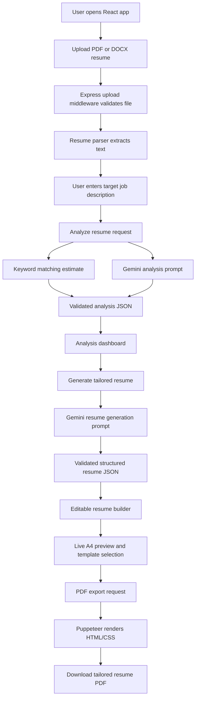
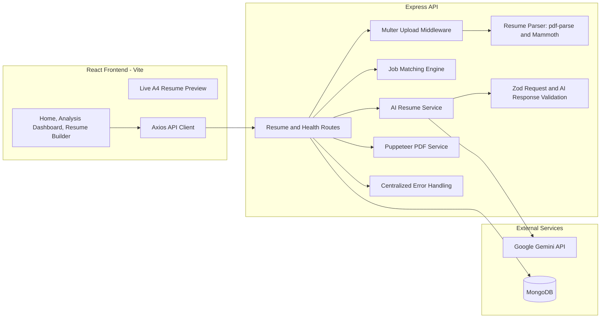
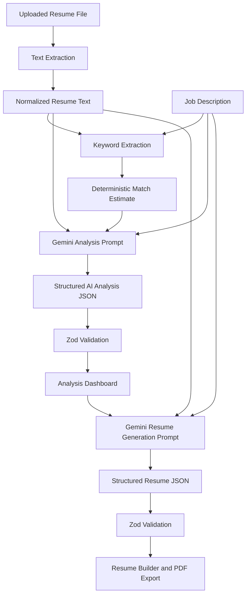
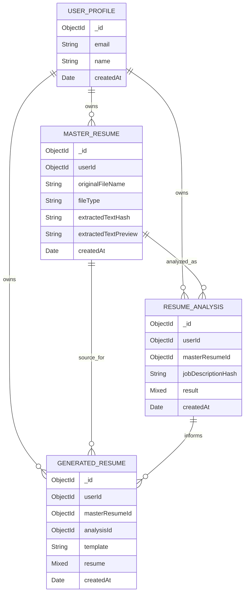

# ApplyWise — AI Resume Analyzer & Resume Builder

> A full-stack MERN application that analyzes a resume against a target job description, identifies fit gaps, generates a factual tailored resume with Google Gemini, and exports an editable ATS-friendly resume as a PDF.


## Table Of Contents

- [Overview](#overview)
- [Current Status](#current-status)
- [Features](#features)
- [User Workflow](#user-workflow)
- [System Architecture](#system-architecture)
- [UI/UX Documentation](#uiux-documentation)
- [Animation & Micro-Interactions](#animation--micro-interactions)
- [AI Processing Architecture](#ai-processing-architecture)
- [Database Design](#database-design)
- [Backend API](#backend-api)
- [Project Structure](#project-structure)
- [Local Installation](#local-installation)
- [Testing & Verification](#testing--verification)
- [Security, Privacy & Limitations](#security-privacy--limitations)
- [Roadmap](#roadmap)
- [FAQ](#faq)

## Overview

Traditional resumes often fail because they describe a candidate broadly instead of communicating relevance for a specific role. Recruiters and applicant tracking workflows usually scan for alignment between a job description and the resume: skills, responsibilities, tools, project evidence, and domain keywords.

AI Resume Analyzer & Resume Builder helps close that gap. The user uploads an existing PDF or DOCX resume, pastes a target job description, and the backend extracts the resume text. Google Gemini then compares the resume against the job description and returns structured analysis: estimated fit score, matched skills, missing skills, relevant experience, weaknesses, ATS recommendations, and improvement suggestions.

After analysis, the user can generate a job-specific resume draft. The application instructs the AI to use only verified information from the original resume, then validates the generated structured JSON before it reaches the frontend. The user can edit the resume, preview it in an A4 layout, select an ATS-friendly template, and download a selectable-text PDF.

This is different from a normal resume builder because it is job-targeted. The product does not only format resume content; it evaluates role fit, highlights gaps, rewrites existing information for relevance, and keeps factual accuracy as a core constraint.

## Current Status

| Area | Status | Notes |
|---|---:|---|
| Resume upload | Implemented | PDF and DOCX uploads with file type and size validation. |
| Text extraction | Implemented | Uses `pdf-parse` and Mammoth. Scanned PDFs are rejected when text is insufficient. |
| AI analysis | Implemented | Gemini returns validated structured JSON. Requires `GEMINI_API_KEY`. |
| Match scoring | Implemented | Keyword coverage estimate plus AI rationale. Not an official ATS score. |
| Tailored resume generation | Implemented | Generates validated structured JSON from verified resume content. |
| Resume builder | Implemented | Editable contact, summary, skills, experience, projects, and education. |
| Live preview | Implemented | A4-style preview with three template accents. |
| PDF export | Implemented | Puppeteer renders sanitized HTML/CSS to PDF. Requires bundled or configured browser. |
| MongoDB persistence | Implemented with fallback | Stores metadata/hashes/results only when MongoDB is connected; guest flow works without persistence. |
| Authentication | Planned | Schemas are ready for user relationships, but auth is not implemented. |
| Resume history UI | Planned | Models support versions, but frontend history is not implemented. |
| Per-section AI regeneration | Planned | Not currently implemented in the UI or API. |

## Features

### Implemented

- PDF/DOCX resume upload through drag-and-drop or file picker.
- Server-side file validation with Multer.
- Resume text extraction and normalization.
- Job description input and validation.
- Gemini-powered resume/job analysis.
- Deterministic keyword coverage estimate used as a calibration signal.
- AI output validation with Zod before sending data to the frontend.
- Prompt-injection resistant system instructions for resume and job description content.
- Tailored resume generation as structured JSON.
- Editable resume builder.
- Live A4 resume preview.
- Template selection: `Classic`, `Modern`, and `Compact`.
- PDF generation using Puppeteer and sanitized HTML.
- Centralized backend error handling.
- Basic API rate limiting.
- MongoDB models for future authenticated workflows.
- Automated tests for matching, JSON extraction, PDF template sanitization, and frontend resume mutators.

### Planned

- User authentication and account-based storage.
- Resume version history and restore.
- Cover letter generation.
- Per-section AI regeneration.
- More resume templates.
- Advanced analytics dashboard.
- Saved job descriptions.
- Cloud file storage with explicit retention controls.
- End-to-end browser tests.
- Screenshots and demo GIFs for GitHub presentation.

## User Workflow

### Step 1 - Upload Resume

The user uploads a PDF or DOCX resume. The backend validates MIME type and file size, stores the upload temporarily, extracts text, rejects unsupported/scanned files when text extraction is insufficient, and deletes the temporary file.

### Step 2 - Enter Job Description

The user pastes a target job description. The backend validates minimum length before sending the content to AI analysis.

### Step 3 - AI Resume Analysis

Gemini compares the extracted resume text and job description. The application also calculates a deterministic keyword coverage estimate. The AI returns matched skills, missing skills, relevant experience, missing requirements, strengths, weaknesses, ATS recommendations, improvement suggestions, and a match-score rationale.

### Step 4 - Analysis Dashboard

The frontend displays the estimated match score, matched skills, gaps, strengths, weaknesses, and recommendations. The score is explicitly presented as an estimate, not an official ATS result.

### Step 5 - AI Resume Generation

The user clicks **Generate Tailored Resume**. Gemini creates a structured resume draft using only information supported by the original resume. The generated response is validated before the frontend receives it.

### Step 6 - Resume Builder

The user edits personal information and resume sections, selects a template, and previews the resume in a live A4 layout.

### Step 7 - PDF Export

The final resume JSON is sent to the backend. Puppeteer renders an ATS-friendly HTML/CSS template and returns a PDF download.



## System Architecture

The application uses a Vite React frontend and an Express backend. AI calls are performed only on the backend so the Gemini API key is never exposed to browser code. MongoDB persistence is optional for the guest MVP: if MongoDB is connected, metadata and generated outputs are saved; if not, the workflow still runs in memory for the active session.



### Data Movement

| Stage | Data | Current Behavior |
|---|---|---|
| Upload | PDF/DOCX file | Temporarily written to `backend/uploads`, parsed, then deleted. |
| Extraction | Plain resume text | Returned to frontend for guest workflow; hash/preview stored only if MongoDB is connected. |
| Analysis | Resume text + job description | Sent to Gemini from backend only. AI response is parsed and validated. |
| Generation | Resume text + job description + analysis | Gemini returns structured resume JSON. Zod validates shape. |
| Editing | Structured resume JSON | Stored in React state while the user edits. |
| PDF | Structured resume JSON + template | Backend renders sanitized HTML to PDF with Puppeteer. |

## UI/UX Documentation

The current frontend uses a clean SaaS-style interface with restrained colors, strong hierarchy, reusable panels, icon buttons, responsive grids, and clear loading/error states.

### Home / Upload Page

Implemented in `frontend/src/pages/HomePage.jsx`.

- Premium two-column hero layout on desktop.
- Responsive single-column layout on smaller screens.
- Hero copy explains the role-targeted workflow.
- Feature tiles: PDF/DOCX parsing, skill-gap analysis, editable PDF export.
- Drag-and-drop upload area with dashed border and upload icon.
- Hidden file input triggered by clicking the upload panel.
- Job description textarea with focus ring.
- Primary **Analyze Resume** CTA.
- Loading spinner while upload or analysis requests are running.
- Inline error message for API failures.

### AI Analysis Dashboard

Implemented in `frontend/src/pages/AnalysisPage.jsx`.

- Header identifies the uploaded resume.
- Metric cards show estimated match score, matched keyword count, and gap count.
- Score rationale appears in a dedicated panel.
- Matched skills and missing skills use tag lists.
- Relevant experience, missing requirements, strengths, weaknesses, ATS recommendations, and improvement suggestions appear in organized insight blocks.
- **Generate Tailored Resume** CTA includes a spinner while the AI generation request is running.
- Empty state appears if the user navigates to analysis before running an analysis.

### AI Resume Builder

Implemented in `frontend/src/pages/BuilderPage.jsx`.

- Left column contains editable resume fields.
- Right column contains sticky live A4 preview on large screens.
- Template selector supports `Classic`, `Modern`, and `Compact`.
- Editable fields include contact information, headline, summary, skills, experience, projects, and education.
- Users can add or remove skill groups, experience entries, project entries, and education entries.
- **Download PDF** CTA sends the final resume JSON to the backend.

### Visual Design System

| Element | Current Implementation |
|---|---|
| Typography | System UI stack with bold hierarchy and compact form text. |
| Primary color | `ink` (`#10212f`) for headers and primary buttons. |
| Accent color | `river` (`#167c80`) for focus states and labels. |
| Highlight color | `citrus` (`#d6f36b`) for the generation CTA. |
| Surface color | White panels over a soft `#f7faf8` body background. |
| Panels | 8px radius, light border, soft shadow. |
| Buttons | Rounded 6px, icon + label, disabled state, hover transitions. |
| Forms | Clear labels, border focus states, textareas for long sections. |
| Responsiveness | CSS grid breakpoints for desktop, tablet, and mobile. |

### Accessibility Notes

Implemented:

- Native buttons and form controls.
- Visible labels for major fields.
- Disabled states for unavailable actions.
- Error messages shown close to the related workflow.

Planned:

- More complete ARIA descriptions for upload and preview regions.
- Keyboard-first drag/drop alternative documentation.
- `prefers-reduced-motion` CSS layer when richer animations are added.
- Higher-fidelity screen-reader announcements for async states.

### Planned UI/UX Enhancements

- Animated match score count-up.
- Step progress indicator with completion state.
- Upload success checkmark.
- Section-level AI regeneration controls.
- Resume comparison view for original vs tailored content.
- More template previews before selection.
- Toast notifications for PDF success/failure.
- Demo screenshots and GIFs in this README.

## Animation & Micro-Interactions

Current implementation uses simple Tailwind transitions for hover, focus, border, and button states. Lucide spinner icons are used during API requests.

The table below documents proposed animation specifications. These are product design targets, not claims that all animations are implemented today.

| UI Element | Animation Type | Trigger | Duration | Expected Behavior | Status |
|---|---|---:|---:|---|---|
| Hero section | Fade + slide-up | Page load | 500-700ms | Smooth entrance without delaying interaction. | Planned |
| Upload card | Border/glow transition | Drag-over | 200ms | Indicates active drop target. | Partially implemented via hover/border transition |
| Upload success | Checkmark reveal | Successful upload | 300ms | Confirms upload and extraction. | Planned |
| Analyze button | Loading spinner | API request | Continuous | Shows processing. | Implemented |
| Match score | Count-up | Results loaded | 800-1200ms | Reveals score progressively. | Planned |
| Result cards | Staggered entrance | Results loaded | 300-500ms | Sequential reveal of insights. | Planned |
| Resume preview | Smooth transition | Content update | 200-300ms | Reduces visual jump while editing. | Planned |
| Template selection | Border transition | Selection | 200ms | Highlights selected template. | Implemented with state styling |
| PDF download | Progress/success feedback | PDF creation | State-based | Indicates download preparation and completion. | Partially implemented with loading label |

When richer motion is added, the UI should include `prefers-reduced-motion` support and avoid animations that block form input or resume editing.

## AI Processing Architecture

The backend keeps all LLM operations in `backend/src/ai`. The frontend never receives or stores the Gemini API key.

### LLM Workflow

1. `resumeParser` extracts raw text from the uploaded PDF/DOCX.
2. `matchingService` calculates a deterministic keyword coverage estimate.
3. `resumeAiService` builds a Gemini prompt with strict system rules.
4. Gemini returns JSON for analysis or resume generation.
5. `jsonHelpers.extractJson` extracts JSON from the model response.
6. Zod validates the response against `analysisResponseSchema` or `generatedResumeSchema`.
7. Validated data is returned to the frontend.
8. Invalid JSON or schema mismatch returns a safe API error.



### Factual Accuracy Controls

Implemented controls:

- Prompts explicitly instruct Gemini not to invent employment history, skills, achievements, qualifications, certifications, dates, employers, or metrics.
- Resume and job descriptions are treated as untrusted text.
- Prompt-injection instructions inside resumes/job descriptions are explicitly ignored.
- AI must leave unknown fields empty instead of guessing.
- The generated resume is constrained to a structured schema.
- The match score includes a disclaimer: it is an application estimate, not an official ATS score.

Limitations:

- The system does not yet perform independent fact-checking beyond prompt constraints and schema validation.
- It does not yet highlight every generated sentence against source evidence.
- Human review is still required before submitting a resume.

## Database Design

MongoDB is configured with Mongoose. Persistence is opportunistic in the MVP: if MongoDB is connected, records are saved; if MongoDB is unavailable, the guest workflow still runs.

### Implemented Models

#### `UserProfile`

| Field | Type | Notes |
|---|---|---|
| `email` | String | Indexed, sparse. |
| `name` | String | Optional display name. |
| `createdAt` | Date | Defaults to current date. |

#### `MasterResume`

| Field | Type | Notes |
|---|---|---|
| `userId` | ObjectId -> `UserProfile` | Defaults to `null` for guest MVP. |
| `originalFileName` | String | Uploaded file name. |
| `fileType` | String | MIME type. |
| `extractedTextHash` | String | SHA-256 hash of extracted text. |
| `extractedTextPreview` | String | First 500 characters only. |
| `createdAt` | Date | Defaults to current date. |

#### `ResumeAnalysis`

| Field | Type | Notes |
|---|---|---|
| `userId` | ObjectId -> `UserProfile` | Defaults to `null`. |
| `masterResumeId` | ObjectId -> `MasterResume` | Optional relation. |
| `jobDescriptionHash` | String | SHA-256 hash of job description. |
| `result` | Mixed | Validated analysis object. |
| `createdAt` | Date | Defaults to current date. |

#### `GeneratedResume`

| Field | Type | Notes |
|---|---|---|
| `userId` | ObjectId -> `UserProfile` | Defaults to `null`. |
| `masterResumeId` | ObjectId -> `MasterResume` | Optional relation. |
| `analysisId` | ObjectId -> `ResumeAnalysis` | Optional relation. |
| `template` | String | Defaults to `classic`. |
| `resume` | Mixed | Structured generated resume JSON. |
| `createdAt` | Date | Defaults to current date. |



### Planned Database Architecture

- Authenticated user ownership.
- Resume version history UI.
- Saved job descriptions.
- Deletion and retention policies exposed to users.
- Audit fields such as `updatedAt`, `deletedAt`, and explicit consent metadata.

## Backend API

Base URL in local development:

```text
http://localhost:5000/api
```

All JSON responses use this general shape:

```json
{
  "success": true,
  "data": {}
}
```

Errors use this shape:

```json
{
  "success": false,
  "error": {
    "message": "Invalid request payload."
  }
}
```

### `GET /api/health`

Checks whether the API is running.

Example response:

```json
{
  "success": true,
  "data": {
    "status": "ok",
    "service": "ai-resume-api"
  }
}
```

### `POST /api/resumes/upload`

Uploads and extracts a resume file.

| Property | Value |
|---|---|
| Content type | `multipart/form-data` |
| File field | `resume` |
| Supported files | PDF, DOCX |
| Size limit | Controlled by `UPLOAD_MAX_MB` |

Example request:

```bash
curl -X POST http://localhost:5000/api/resumes/upload \
  -F "resume=@resume.pdf"
```

Example successful response:

```json
{
  "success": true,
  "data": {
    "resumeText": "Extracted resume text...",
    "masterResumeId": null,
    "originalFileName": "resume.pdf",
    "characterCount": 4230
  }
}
```

Common errors:

| Status | Cause |
|---:|---|
| 400 | Missing file or unsupported file type. |
| 413 | File exceeds upload size limit. |
| 422 | Not enough text extracted, commonly from scanned PDFs. |

### `POST /api/resumes/analyze`

Analyzes extracted resume text against a job description.

Required body:

```json
{
  "resumeText": "At least 100 characters of extracted resume text...",
  "jobDescription": "At least 80 characters of job description text...",
  "masterResumeId": "optional MongoDB id"
}
```

Example request:

```bash
curl -X POST http://localhost:5000/api/resumes/analyze \
  -H "Content-Type: application/json" \
  -d "{\"resumeText\":\"...\",\"jobDescription\":\"...\"}"
```

Example successful response:

```json
{
  "success": true,
  "data": {
    "analysis": {
      "matchScore": 72,
      "matchedTechnicalSkills": ["React", "Node.js"],
      "missingRequiredSkills": ["AWS"],
      "relevantWorkExperience": ["Built full-stack applications with React and Node.js."],
      "missingJobRequirements": ["Cloud deployment experience is not evident."],
      "strengths": ["Full-stack JavaScript background."],
      "weaknesses": ["Limited cloud evidence in resume."],
      "atsRecommendations": ["Use standard section headings."],
      "improvementSuggestions": ["Add relevant deployment projects if supported by experience."],
      "scoreRationale": "The resume matches several core JavaScript requirements but lacks cloud evidence.",
      "deterministicEstimate": {
        "score": 60,
        "matched": ["react", "node"],
        "missing": ["aws"]
      },
      "disclaimer": "This score is an estimated resume-to-job fit signal, not an official ATS score."
    },
    "analysisId": null
  }
}
```

Common errors:

| Status | Cause |
|---:|---|
| 400 | Body fails Zod validation. |
| 503 | `GEMINI_API_KEY` is missing. |
| 502 | Gemini returns invalid or schema-incompatible JSON. |

### `POST /api/resumes/generate`

Generates a tailored structured resume.

Required body:

```json
{
  "resumeText": "Extracted resume text...",
  "jobDescription": "Target job description...",
  "analysis": {
    "matchScore": 72,
    "matchedTechnicalSkills": [],
    "missingRequiredSkills": [],
    "relevantWorkExperience": [],
    "missingJobRequirements": [],
    "strengths": [],
    "weaknesses": [],
    "atsRecommendations": [],
    "improvementSuggestions": [],
    "scoreRationale": "..."
  }
}
```

Example successful response:

```json
{
  "success": true,
  "data": {
    "resume": {
      "contact": {
        "name": "Candidate Name",
        "email": "candidate@example.com",
        "phone": "",
        "location": "",
        "links": []
      },
      "headline": "Full-Stack Developer",
      "summary": "Role-targeted professional summary...",
      "skills": [
        {
          "category": "Frontend",
          "items": ["React", "JavaScript"]
        }
      ],
      "experience": [],
      "projects": [],
      "education": [],
      "certifications": [],
      "additionalSections": []
    },
    "generatedResumeId": null
  }
}
```

Common errors:

| Status | Cause |
|---:|---|
| 400 | Missing or too-short resume/job text. |
| 503 | Gemini API key not configured. |
| 502 | Generated resume does not match the expected schema. |

### `POST /api/resumes/pdf`

Generates a downloadable PDF from structured resume JSON.

Required body:

```json
{
  "template": "classic",
  "resume": {
    "contact": {
      "name": "Candidate Name",
      "email": "candidate@example.com",
      "phone": "",
      "location": "",
      "links": []
    },
    "headline": "Full-Stack Developer",
    "summary": "Summary...",
    "skills": [],
    "experience": [],
    "projects": [],
    "education": [],
    "certifications": [],
    "additionalSections": []
  }
}
```

Valid templates:

- `classic`
- `modern`
- `compact`

Successful response:

```text
Content-Type: application/pdf
Content-Disposition: attachment; filename="tailored-resume.pdf"
```

Common errors:

| Status | Cause |
|---:|---|
| 400 | Invalid resume JSON or unsupported template. |
| 500 | Puppeteer cannot launch a browser. Set `PUPPETEER_EXECUTABLE_PATH` if needed. |

## Project Structure

```text
ai-resume/
├── backend/
│   ├── .env.example
│   ├── package.json
│   ├── src/
│   │   ├── ai/
│   │   │   ├── geminiClient.js
│   │   │   ├── jsonHelpers.js
│   │   │   └── resumeAiService.js
│   │   ├── config/
│   │   │   ├── database.js
│   │   │   └── env.js
│   │   ├── controllers/
│   │   │   └── resumeController.js
│   │   ├── middlewares/
│   │   │   ├── errorHandler.js
│   │   │   ├── rateLimit.js
│   │   │   ├── upload.js
│   │   │   └── validate.js
│   │   ├── models/
│   │   │   ├── GeneratedResume.js
│   │   │   ├── MasterResume.js
│   │   │   ├── ResumeAnalysis.js
│   │   │   └── UserProfile.js
│   │   ├── routes/
│   │   │   ├── healthRoutes.js
│   │   │   └── resumeRoutes.js
│   │   ├── services/
│   │   │   ├── matchingService.js
│   │   │   ├── pdfService.js
│   │   │   ├── pdfTemplateService.js
│   │   │   ├── resumeParser.js
│   │   │   ├── resumePersistenceService.js
│   │   │   └── tempFileService.js
│   │   ├── utils/
│   │   │   ├── AppError.js
│   │   │   └── hash.js
│   │   ├── validation/
│   │   │   └── resumeSchemas.js
│   │   ├── app.js
│   │   └── server.js
│   └── tests/
│       ├── jsonHelpers.test.js
│       ├── matchingService.test.js
│       └── pdfTemplateService.test.js
├── frontend/
│   ├── .env.example
│   ├── package.json
│   ├── index.html
│   ├── postcss.config.js
│   ├── tailwind.config.js
│   └── src/
│       ├── components/
│       │   ├── Button.jsx
│       │   ├── MetricCard.jsx
│       │   ├── Panel.jsx
│       │   ├── ResumePreview.jsx
│       │   └── TagList.jsx
│       ├── data/
│       │   └── emptyResume.js
│       ├── pages/
│       │   ├── AnalysisPage.jsx
│       │   ├── BuilderPage.jsx
│       │   └── HomePage.jsx
│       ├── services/
│       │   └── api.js
│       ├── utils/
│       │   ├── resumeMutators.js
│       │   └── resumeMutators.test.js
│       ├── App.jsx
│       ├── main.jsx
│       └── styles.css
├── .gitignore
├── package.json
└── README.md
```

### Folder Responsibilities

| Folder | Responsibility |
|---|---|
| `frontend/src/components` | Reusable UI building blocks and resume preview. |
| `frontend/src/pages` | Main application screens. |
| `frontend/src/services` | Axios API client and file/PDF request helpers. |
| `frontend/src/utils` | Immutable resume state update helpers. |
| `backend/src/controllers` | Request handlers for upload, analysis, generation, and PDF export. |
| `backend/src/routes` | Express route definitions. |
| `backend/src/models` | Mongoose schemas for persistence-ready architecture. |
| `backend/src/ai` | Gemini client, prompt workflow, JSON parsing. |
| `backend/src/services` | Resume parsing, matching, persistence, temp cleanup, PDF rendering. |
| `backend/src/validation` | Zod request and AI response schemas. |
| `backend/src/middlewares` | Upload validation, rate limiting, and centralized errors. |

## Local Installation

### Prerequisites

- Node.js 20+ recommended.
- npm 10+ recommended.
- MongoDB local instance or MongoDB Atlas connection string.
- Google Gemini API key.
- Chrome/Chromium for PDF generation if Puppeteer does not download its bundled browser.

### 1. Clone The Repository

```bash
git clone <your-repository-url>
cd ai-resume
```

### 2. Install Dependencies

Install root tooling:

```bash
npm install
```

Install backend and frontend dependencies:

```bash
npm run install:all
```

You can also install separately:

```bash
npm install --prefix backend
npm install --prefix frontend
```

### 3. Create Environment Files

macOS/Linux:

```bash
cp backend/.env.example backend/.env
cp frontend/.env.example frontend/.env
```

Windows PowerShell:

```powershell
Copy-Item backend/.env.example backend/.env
Copy-Item frontend/.env.example frontend/.env
```

### 4. Configure Backend Environment

Edit `backend/.env`:

```env
PORT=5000
NODE_ENV=development
CLIENT_ORIGIN=http://localhost:5173
MONGODB_URI=mongodb://127.0.0.1:27017/ai_resume
GEMINI_API_KEY=your_google_gemini_api_key
GEMINI_MODEL=gemini-2.5-flash
GEMINI_FALLBACK_MODEL=gemini-3.6-flash
GEMINI_SECONDARY_FALLBACK_MODEL=gemini-3.5-flash-lite
PUPPETEER_EXECUTABLE_PATH=
UPLOAD_MAX_MB=5
RATE_LIMIT_WINDOW_MS=900000
RATE_LIMIT_MAX=100
```

Notes:

- Do not commit `.env` files.
- `GEMINI_API_KEY` must stay on the backend.
- If Puppeteer was installed with browser download disabled, set `PUPPETEER_EXECUTABLE_PATH` to Chrome or Chromium before PDF export.

### 5. Configure Frontend Environment

Edit `frontend/.env`:

```env
VITE_API_BASE_URL=http://localhost:5000/api
```

### 6. Start The Application

Run both servers from the root:

```bash
npm run dev
```

Or run them separately:

```bash
npm run dev --prefix backend
npm run dev --prefix frontend
```

Local URLs:

| Service | URL |
|---|---|
| Frontend | http://localhost:5173 |
| Backend | http://localhost:5000 |
| Health Check | http://localhost:5000/api/health |

## Testing & Verification

### Automated Tests

Run all tests:

```bash
npm test
```

Run backend tests:

```bash
npm test --prefix backend
```

Run frontend tests:

```bash
npm test --prefix frontend
```

Build the frontend:

```bash
npm run build --prefix frontend
```

### Verified Results

The following checks were executed successfully on 2026-10-11:

| Command | Result |
|---|---|
| `npm test --prefix backend` | Passed: 6 tests |
| `npm test --prefix frontend` | Passed: 2 tests |
| `npm run build --prefix frontend` | Passed |

Current automated coverage:

- `matchingService` keyword extraction and match estimate.
- `jsonHelpers` AI JSON extraction.
- `pdfTemplateService` HTML escaping and core section rendering.
- `resumeMutators` immutable frontend state updates.

### Manual End-To-End Checklist

- [ ] Start MongoDB or confirm guest fallback behavior is acceptable.
- [ ] Add a valid `GEMINI_API_KEY`.
- [ ] Open http://localhost:5173.
- [ ] Upload a valid PDF resume.
- [ ] Upload a valid DOCX resume.
- [ ] Confirm unsupported files are rejected.
- [ ] Confirm scanned/empty PDFs return a clear extraction error.
- [ ] Paste a realistic job description.
- [ ] Run AI analysis.
- [ ] Verify matched skills and skill gaps are plausible.
- [ ] Confirm the match score is treated as an estimate.
- [ ] Generate a tailored resume.
- [ ] Review factual consistency against the original resume.
- [ ] Edit resume fields in the builder.
- [ ] Switch between `Classic`, `Modern`, and `Compact` templates.
- [ ] Preview final A4 layout.
- [ ] Generate and download the PDF.
- [ ] Open the PDF and confirm text is selectable.

## Security, Privacy & Limitations

### Implemented Controls

- Gemini API key is read only from backend environment variables.
- Frontend uses `VITE_API_BASE_URL` only; no AI credentials are exposed.
- Helmet sets common HTTP security headers.
- CORS restricts requests to `CLIENT_ORIGIN`.
- Rate limiting is enabled through `express-rate-limit`.
- Multer validates upload type and size.
- Temporary uploaded files are deleted after extraction.
- Raw resume text is not permanently stored by the implemented persistence service.
- Stored resume records use `extractedTextHash` and a short preview.
- Job descriptions are stored as hashes when analysis persistence is available.
- AI responses are validated with Zod.
- PDF template content is HTML-escaped before rendering.
- Prompts explicitly defend against prompt injection and fabricated claims.

### Limitations

- No authentication or user authorization yet.
- No user-facing data deletion controls yet.
- No OCR for scanned PDFs.
- No malware scanning for uploaded documents.
- No independent factual verification beyond source prompt constraints and user review.
- No production logging/monitoring setup.
- No deployed infrastructure configuration.
- Third-party AI processing depends on Google Gemini's API behavior and data policies.

### Privacy Guidance

Because resumes contain personal information, production deployment should add:

- Explicit user consent and retention policy.
- Authenticated data access.
- Resume deletion/export controls.
- Optional no-storage mode.
- Encrypted storage for sensitive fields.
- Secure production logging that excludes resume content.

## Roadmap

### Phase 1 - Core MVP

- [x] Resume upload.
- [x] PDF/DOCX text extraction.
- [x] Job description input.
- [x] AI resume analysis.
- [x] Estimated match score.
- [x] Tailored resume generation.
- [x] Editable resume builder.
- [x] Template selection.
- [x] PDF export.
- [x] Basic automated tests.

### Phase 2 - Advanced Resume Builder

- [ ] More ATS-friendly templates.
- [ ] Resume history and version restore.
- [ ] Master resume profile editor.
- [ ] Original vs tailored resume comparison.
- [ ] Cover letter generation.
- [ ] Section-level AI regeneration.
- [ ] Richer template previews.

### Phase 3 - Full SaaS

- [ ] User authentication.
- [ ] Cloud storage with retention controls.
- [ ] User dashboards.
- [ ] Usage limits.
- [ ] Subscription-ready architecture.
- [ ] Organization/team support.
- [ ] Production observability.

### Phase 4 - Advanced AI

- [ ] Interview preparation from resume/job description.
- [ ] Job recommendations.
- [ ] Multi-resume comparison.
- [ ] Personalized career insights.
- [ ] Evidence-backed resume rewrite review.
- [ ] Recruiter-style feedback reports.

## Recommended GitHub Assets

No screenshots, demo GIFs, or architecture images currently exist in the repository. Recommended future assets:

- `docs/screenshots/upload-page.png`
- `docs/screenshots/analysis-dashboard.png`
- `docs/screenshots/resume-builder.png`
- `docs/demo/full-workflow.gif`
- `docs/images/pdf-output-preview.png`

These should be added only after the files exist so the README does not contain broken links.

## FAQ

<details>
<summary>Does the app store my full resume?</summary>

The implemented persistence service does not store the full extracted resume text. If MongoDB is connected, it stores a hash and a short extracted-text preview for the master resume, plus analysis/generated resume records. The guest workflow can run without MongoDB.

</details>

<details>
<summary>Is the match score an official ATS score?</summary>

No. It is an application-generated estimate based on deterministic keyword coverage and Gemini analysis. It should be used as guidance, not as a guarantee of recruiter or ATS performance.

</details>

<details>
<summary>Can the AI invent missing experience?</summary>

The prompts explicitly prohibit invented employment history, skills, certifications, dates, metrics, and achievements. The output is schema-validated, but users should still review every generated resume before submission.

</details>

<details>
<summary>Why does PDF export require Chrome or Chromium?</summary>

The backend uses Puppeteer to render HTML/CSS into a selectable-text PDF. Puppeteer normally downloads a compatible browser during installation. If that download is skipped, configure `PUPPETEER_EXECUTABLE_PATH`.

</details>

<details>
<summary>Can this run without MongoDB?</summary>

Yes for the guest MVP workflow. The backend logs a warning if MongoDB is unavailable and continues processing uploads, AI analysis, generation, and PDF export without persistence.

</details>

## License

No license file is currently included. Add a license before distributing or accepting external contributions.
